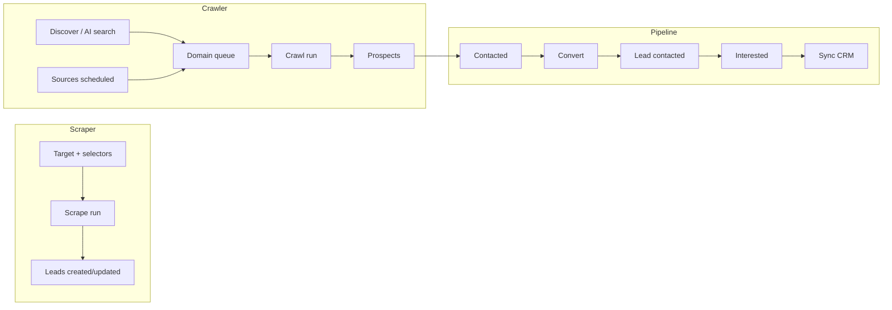

# Dashboard Frontend — Rework Reference

This document captures the **current state** of the React dashboard (`frontend/`) so you can redesign and rebuild it with clearer architecture, better UX, and less duplication. It is intended as a **spec + audit**, not a migration plan by itself.

---

## 1. What this app is

A **session-authenticated SPA** for operating a lead-generation pipeline:

| Domain | Purpose | Staff can… | Admin additionally… |
|--------|---------|------------|---------------------|
| **Scraper** | Pull listings from configured URLs (CSS selectors) | Create/edit targets, trigger per-target scrapes, view runs | See all users’ targets/runs, trigger any target |
| **Crawler** | Discover domains (SERP / AI), crawl sites, score prospects | Discover, queue domains, monitor runs | Manage global sources, reset failed domains, cancel runs |
| **Pipeline** | Qualify prospects → leads → CRM | Bulk/row actions on prospects & leads | Oversight counts; links to staff views |

**Users**

- **Staff** (`role: staff`): members of Django group `scraper` (configurable via `SCRAPER_GROUP_NAME`), **not** `is_staff`. Routes under `/`.
- **Admin** (`role: admin`): Django `is_staff` users. Routes under `/admin`.
- Both use the **same login** (`/login`) and session cookie; `ProtectedRoute` enforces role separation.

**Backend**

- All JSON under `/dashboard/api/*` (Django).
- Dev: Vite `:5173` proxies `/dashboard` → Django `:8000`.
- Prod option: `DJANGO_SERVE_SPA=1` serves `frontend/dist` from Django (same origin).

**Legacy**

- Django **template** dashboard still exists at `/dashboard/` (HTML views in `backend/dashboard/views.py`). The React app has largely superseded it for both staff and admin, but exports, wizard, and some admin HTML pages remain backend-only.

---

## 2. Tech stack

| Layer | Choice | Notes |
|-------|--------|-------|
| Build | Vite 8 + React 19 + TypeScript | React Compiler enabled (`babel-plugin-react-compiler`) |
| Routing | React Router 7 (`createBrowserRouter`) | Lazy-loaded pages |
| Data | TanStack Query v5 | Global defaults: `staleTime: 60s`, `retry: 1`, no refetch on focus |
| HTTP | Axios (`apiClient`) | CSRF cookies, `withCredentials: true` |
| Styling | Tailwind CSS 4 + shadcn **radix-nova** | Ateric brand tokens in `src/index.css` |
| Icons | lucide-react | |
| Charts | recharts | Used on staff home only |
| UI primitives | **Only `Button`** from shadcn | Tables, inputs, selects are raw HTML + Tailwind |
| Mobile nav | @headlessui/react Dialog | Drawer sidebar |

**Installed but unused in `src/`**

- `@tanstack/react-table`
- `react-hook-form`
- `zod`

**Dead API client exports** (defined in `dashboard.ts`, never imported by pages):

- `triggerScrape`, `getRunStatus`, `retryRun` (legacy `/dashboard/api/runs/*` paths)
- `subscribeRunsStream`, `fetchNotifications`

---

## 3. Repository layout

```
frontend/
├── index.html
├── vite.config.ts          # @ alias, /dashboard proxy
├── components.json         # shadcn config (radix-nova)
├── .env.example            # VITE_API_BASE, VITE_DJANGO_PROXY_TARGET
└── src/
    ├── main.tsx            # RouterProvider
    ├── App.tsx
    ├── index.css           # Design tokens (Ateric red/navy)
    ├── app/
    │   ├── router.tsx      # Route tree
    │   ├── lazyPages.ts    # Code-split exports
    │   ├── navigation.ts   # Staff sidebar sections
    │   ├── adminNavigation.ts
    │   └── providers.tsx   # QueryClient + AuthProvider
    ├── contexts/
    │   └── AuthContext.tsx
    ├── lib/
    │   ├── api/
    │   │   ├── client.ts   # axios instance
    │   │   ├── auth.ts
    │   │   └── dashboard.ts # ALL types + API functions (~795 lines)
    │   └── utils.ts        # cn()
    ├── components/
    │   ├── layout/         # DashboardLayout, AdminLayout, sidebars
    │   ├── admin/          # Shared admin table sections + subnav
    │   ├── ui/button.tsx   # Only shadcn component
    │   ├── ProtectedRoute.tsx
    │   ├── RouteErrorPage.tsx
    │   ├── PageContentSkeleton.tsx
    │   └── *LoadingFallback.tsx
    └── pages/
        ├── LoginPage.tsx
        ├── HomePage.tsx              # Staff dashboard
        ├── PlaceholderPage.tsx       # Unused in router (legacy)
        ├── admin/                    # 13 admin pages
        └── staff/                    # 14 staff pages
```

**~72 source files total.** No `hooks/`, `features/`, or shared `components/data-table/` layer yet.

---

## 4. Routing

### 4.1 Public

| Path | Component | Notes |
|------|-----------|-------|
| `/login` | `LoginPage` | Redirects authenticated users to `/` or `/admin` |

### 4.2 Staff (`ProtectedRoute allowRoles={['staff']}` + `DashboardLayout`)

| Path | Page | Primary API |
|------|------|-------------|
| `/` | `HomePage` | `fetchMetricsSummary` |
| `/targets` | `TargetsPage` | `listTargets`, `triggerTarget` |
| `/targets/:targetId` | `TargetFormPage` | `getTarget`, `createTarget`, `updateTarget` (`new` = create) |
| `/runs` | `RunsPage` | `listScrapeRuns`, `retryScrapeRun` |
| `/runs/:runId` | `RunDetailPage` | `getScrapeRun` |
| `/crawler` | `CrawlerHomePage` | Many crawl endpoints (hub) |
| `/crawler/discover` | `CrawlerDiscoverPage` | `crawlerPreview`, `crawlerQueue` |
| `/crawler/domains` | `CrawlerDomainsPage` | `listCrawlDomains`, `triggerCrawlDomain` |
| `/crawler/runs` | `CrawlerRunsPage` | `listCrawlRuns`, cancel/trigger |
| `/crawler/runs/:runId` | `CrawlerRunDetailPage` | `getCrawlRun`, `listCrawlRunDomainResults` |
| `/crawler/ai-search` | `AiSearchPage variant="staff"` | AI search v1 |
| `/prospects` | `ProspectsPage` | `listProspects`, bulk + row actions |
| `/prospects/:prospectId` | `ProspectDetailPage` | `getProspect`, actions |
| `/leads` | `LeadsPage` | `listLeads`, bulk + row actions |
| `/leads/:leadId` | `LeadDetailPage` | `getLead`, CRM sync |

### 4.3 Admin (`ProtectedRoute allowRoles={['admin']}` + `AdminLayout`)

| Path | Page | Notes |
|------|------|-------|
| `/admin` | `AdminHomePage` | Metrics + quick links |
| `/admin/users` | `AdminUsersPage` | CRUD staff, ownership transfer |
| `/admin/scraper` | `AdminScraperOpsPage` | Composite: stats + targets + runs sections |
| `/admin/scraper/targets` | `AdminScraperTargetsPage` | Targets section only |
| `/admin/scraper/runs` | `AdminScraperRunsPage` | Runs section only |
| `/admin/crawler` | `AdminCrawlerOpsPage` | Composite crawler ops |
| `/admin/crawler/sources` | `AdminCrawlerSourcesPage` | Sources section |
| `/admin/crawler/domains` | `AdminCrawlerDomainsPage` | Domains section |
| `/admin/crawler/runs` | `AdminCrawlerRunsPage` | Runs section |
| `/admin/ai-search` | `AiSearchPage variant="admin"` | Can delegate `owner_id` |
| `/admin/pipeline` | `AdminPipelinePage` | **Thin**: counts + links to staff routes |
| `/admin/monitoring` | `AdminMonitoringPage` | Failed scrape + crawl runs |
| `/admin/audit` | `AdminAuditPage` | Paginated activity log |
| `/admin/settings` | `AdminSettingsPage` | Read-only integration status |

### 4.4 Layout behavior

Both layouts share the same pattern:

- Fixed desktop sidebar (`w-60` staff / `w-64` admin)
- Sticky header with hamburger → Headless UI drawer on mobile
- `<Suspense fallback={<PageContentSkeleton />}>` around `<Outlet />`

Staff header title: **"Scraper dashboard"** (static, not route-aware).

---

## 5. Authentication flow

```
bootstrap (optional) → GET /dashboard/api/auth/me/  (sets CSRF cookie)
Login → POST /dashboard/api/auth/login/  { username, password }
Logout → POST /dashboard/api/auth/logout/
Session check → GET /dashboard/api/auth/me/  → MeResponse
```

**`MeResponse`**

```ts
| { authenticated: false; reason?: string }
| { authenticated: true; role: 'admin'; username: string }
| { authenticated: true; role: 'staff'; username: string }
```

**`AuthContext`**

- `useQuery(['auth', 'me'])` with `staleTime: 30s`
- `login` / `logout` mutations invalidate `['auth', 'me']`

**Axios client** (`lib/api/client.ts`)

- `baseURL`: `VITE_API_BASE` or `''` (relative)
- `xsrfCookieName: 'csrftoken'`, `X-CSRFToken` header
- `ngrok-skip-browser-warning: true` for tunnel dev

---

## 6. API surface (frontend usage)

Base path: **`/dashboard/api`**. Staff v1: **`/dashboard/api/v1/`**. Admin: **`/dashboard/api/admin/v1/`**.

### 6.1 Auth

| Method | Path | Used by |
|--------|------|---------|
| GET | `/auth/me/` | AuthContext |
| POST | `/auth/login/` | LoginPage |
| POST | `/auth/logout/` | Sidebars |

### 6.2 Staff v1 — Scraper

| Function | Method | Path |
|----------|--------|------|
| `listTargets` | GET | `/v1/targets/` |
| `getTarget` | GET | `/v1/targets/:id/` |
| `createTarget` | POST | `/v1/targets/` |
| `updateTarget` | PATCH | `/v1/targets/:id/` |
| `triggerTarget` | POST | `/v1/targets/:id/trigger/` |
| `listScrapeRuns` | GET | `/v1/scrape-runs/` |
| `getScrapeRun` | GET | `/v1/scrape-runs/:id/` |
| `retryScrapeRun` | POST | `/v1/scrape-runs/:id/retry/` |

### 6.3 Staff v1 — Crawler

| Function | Method | Path |
|----------|--------|------|
| `listCrawlRuns` | GET | `/v1/crawl-runs/` |
| `getCrawlRun` | GET | `/v1/crawl-runs/:id/` |
| `triggerCrawler` | POST | `/v1/crawl-runs/trigger/` |
| `cancelCrawlRun` | POST | `/v1/crawl-runs/:id/cancel/` |
| `cancelAllRunningCrawls` | POST | `/v1/crawl-runs/cancel-all/` |
| `listCrawlRunDomainResults` | GET | `/v1/crawl-runs/:id/domains/` |
| `listCrawlSources` | GET | `/v1/crawl-sources/` |
| `listCrawlDomains` | GET | `/v1/crawl-domains/` |
| `triggerCrawlDomain` | POST | `/v1/crawl-domains/:id/trigger/` |
| `crawlerPreview` | POST | `/crawler/preview/` (legacy path) |
| `crawlerQueue` | POST | `/crawler/queue/` (legacy path) |

### 6.4 Staff v1 — AI search

| Function | Method | Path |
|----------|--------|------|
| `listAiSearchJobs` | GET | `/v1/ai-search/jobs/` |
| `createAiSearchJob` | POST | `/v1/ai-search/jobs/` |
| `getAiSearchJob` | GET | `/v1/ai-search/jobs/:id/` |

### 6.5 Staff v1 — Pipeline

| Function | Method | Path |
|----------|--------|------|
| `listProspects` | GET | `/v1/prospects/` |
| `getProspect` | GET | `/v1/prospects/:id/` |
| `prospectMarkContacted` | POST | `/v1/prospects/:id/mark-contacted/` |
| `prospectConvert` | POST | `/v1/prospects/:id/convert/` |
| `prospectReject` | POST | `/v1/prospects/:id/reject/` |
| `prospectsBulkContacted` | POST | `/v1/prospects/bulk/contacted/` |
| `prospectsBulkConvert` | POST | `/v1/prospects/bulk/convert/` |
| `prospectsBulkReject` | POST | `/v1/prospects/bulk/reject/` |
| `listLeads` | GET | `/v1/leads/` |
| `getLead` | GET | `/v1/leads/:id/` |
| `leadMarkInterested` | POST | `/v1/leads/:id/mark-interested/` |
| `leadReject` | POST | `/v1/leads/:id/reject/` |
| `leadSyncCrm` | POST | `/v1/leads/:id/sync-crm/` |
| `leadsBulkInterested` | POST | `/v1/leads/bulk/interested/` |
| `leadsBulkReject` | POST | `/v1/leads/bulk/reject/` |

### 6.6 Metrics & streaming (partially used)

| Function | Method | Path | UI usage |
|----------|--------|------|----------|
| `fetchMetricsSummary` | GET | `/v1/metrics/summary/` | HomePage, AdminHomePage |
| `subscribeRunsStream` | SSE | `/v1/stream/runs/` | **Not wired** |
| `fetchNotifications` | GET | `/notifications/` | **Not wired** |

### 6.7 Admin v1

| Area | Key functions |
|------|----------------|
| Users | `listAdminUsers`, `createStaffUser`, `updateAdminUser`, `transferOwnership` |
| Activity | `listAdminActivity` |
| Settings | `fetchAdminSettingsStatus` |
| Scraper | `listAdminScraperTargets`, `triggerAdminScraperTarget`, `listAdminScrapeRuns`, `retryAdminScrapeRun` |
| Crawler | `listAdminCrawlerSources`, `updateAdminCrawlerSource`, `listAdminCrawlerDomains`, `triggerAdminCrawlerDomain`, `resetAdminFailedCrawlerDomains`, `listAdminCrawlerRuns`, `cancelAdminCrawlerRun`, `cancelAllAdminCrawlerRuns` |
| AI search | `listAdminAiSearchJobs`, `createAdminAiSearchJob`, `getAdminAiSearchJob` |

### 6.8 Backend endpoints **not** exposed in React

These exist on Django but have **no frontend integration**:

- `GET /dashboard/export/prospects/csv/`
- `GET /dashboard/export/leads/csv/`
- `POST /dashboard/wizard/detect-platform/`
- `POST /dashboard/wizard/create-target/`
- `POST /dashboard/api/v1/targets/trigger/` (trigger all targets)
- `POST /dashboard/api/leads/bulk/sync-crm/`
- SSE `/dashboard/api/v1/stream/runs/:runId/`
- Legacy HTML views under `/dashboard/*` (targets wizard, crawl source CRUD forms, etc.)

### 6.9 Response shapes

**Paginated list** (v1):

```ts
{ success: boolean; data: { items: T[]; page; page_size; total; has_next } }
```

**Single resource**:

```ts
{ success: boolean; data: T }
```

**Mutations**: mix of `{ success, message?, error? }` and axios error `response.data.error`.

**Ownership**: Staff v1 lists are scoped to the authenticated user’s owned records; admin v1 lists are global.

---

## 7. Domain model (TypeScript types)

All types live in `lib/api/dashboard.ts`. Key entities:

### Target (scraper)

- `name`, `enabled`, `target_type` (`html` | `playwright`), `start_url`, `run_every_minutes`
- `config`: JSON with `item_selector` + `fields` map (see `TargetFormPage` default)
- Staff creates/edits; schedule exists but staff workflow is **manual trigger**

### ScrapeRun

- Links to `target`, `status` (`running` | `success` | `failed`), counts, `error_text`, timestamps

### CrawlSource / CrawlDomain / CrawlRun

- **Source**: scheduled discovery query (`discovery_query`, `source_type`, `enabled`, `priority`)
- **Domain**: queue item with `crawl_status` (`pending`, `crawling`, `completed`, `failed`), attempts, `source_url`
- **Run**: batch with `domains_queued`, prospect counts, `summary` on detail

### CrawlRunDomainResult

- Per-domain outcome: `state`, `score`, `score_label`, contact fields, `crawl_error`

### Prospect

- `status`: `new` → `contacted` → `converted` | `rejected`
- Actions: mark contacted (from `new`), convert (from `new`|`contacted`), reject

### Lead

- `status`: `contacted` → `interested` → `synced` | `rejected`
- Convert from prospect creates lead in `contacted`
- CRM sync only from `interested`

### AISearchJob / AISearchResult

- Job lifecycle: `pending` → `generating` → `searching` → `done` | `failed`
- Results include org metadata, translation rationale, optional `queued_domain_id`

### AdminUser

- `role`: derived (`admin` | `staff` | `none`), groups, flags

### MetricsSummary

- 7-day rollups, status breakdowns for charts

---

## 8. Page-level behavior notes

### Staff home (`HomePage`)

- Polls metrics every 15s
- “Attention needed” banners (failed crawls, large new prospect backlog)
- Recharts bar chart with ResizeObserver (prospect + lead status counts)
- Quick-action cards linking to subsystems

### Targets / Target form

- List: client-side search filter, `page_size: 200`, no server pagination UI
- Form: raw JSON textarea for selector config; validates `item_selector` + `fields`
- Route `/targets/new` for create

### Runs

- Polls every 5s
- URL param `?target_id=` synced to filter
- Retry only on failed rows

### Crawler hub (`CrawlerHomePage`)

- **Largest page** (~450 lines): stats, workflow explainer, embedded tables, many mutations
- Duplicate logic with `CrawlerRunsPage` / `CrawlerDomainsPage`

### Discover (`CrawlerDiscoverPage`)

- SERP preview → select URLs → queue with optional auto-crawl
- Manual URL add, example queries, copy helpers

### Prospects / Leads lists

- Checkbox selection + bulk actions
- **No pagination UI** despite API supporting `page` / `has_next`
- Search/status filters trigger new queries (debounce: **none** — fires on every keystroke via state)

### Detail pages

- Minimal read-only cards + same row actions as list
- No edit forms for prospect/lead fields

### Admin ops pages

- **Composite pattern**: `AdminScraperOpsPage` / `AdminCrawlerOpsPage` embed the same sections as dedicated sub-routes
- Shared sections in `components/admin/*-admin-sections.tsx` (~300+ lines each)
- Subnav tabs: `*-admin-subnav.tsx`

### Admin pipeline

- Only totals + links to `/prospects` and `/leads` (staff routes — admin may hit role redirect)

### Admin audit

- Server-side pagination (page 30), filter by action/object_type/search

---

## 9. Data-fetching conventions

### TanStack Query keys (informal registry)

| Key prefix | Pages |
|------------|-------|
| `auth/me` | Global |
| `metrics-summary`, `admin-overview-*` | Dashboards |
| `targets`, `target/:id` | Scraper config |
| `scrape-runs`, `scrape-run/:id` | Scraper runs |
| `crawl-*`, `crawler-*` | Crawler (many overlapping keys) |
| `prospects`, `prospect/:id` | Pipeline |
| `leads`, `lead/:id` | Pipeline |
| `ai-search-jobs`, `ai-search-job` | AI search |
| `admin-*` | Admin tables |

**Pain point**: Inconsistent prefixes (`crawl-runs-home` vs `crawler-runs-page` vs `crawl-runs`) make invalidation fragile.

### Polling (`refetchInterval`)

| Interval | Where |
|----------|-------|
| 3s | AI search job detail (active jobs) |
| 4–5s | Running scrape/crawl run detail, runs lists |
| 8–15s | Admin domain tables, metrics |
| 15–25s | Crawler home domain/run counts |

No global SSE usage despite backend support.

### Error handling

- Typical pattern: cast axios error → `response.data.error` string
- Local `useState` for `message` / `error` banners per page
- No toast system, no error boundary beyond `RouteErrorPage`

### Mutations

- Manual `qc.invalidateQueries` with partial key prefixes
- No optimistic updates

---

## 10. UI / design system

### Brand (`index.css`)

- Background: off-white `#e8eadf`
- Primary: Ateric red `#e31836`
- Secondary: navy `#012269`
- Sidebar: navy gradient theme via `--sidebar-*` tokens
- Font: Geist Variable

### Components actually used

- `Button` (shadcn) — variants: default, outline, secondary, ghost, destructive, link
- Raw `<input>`, `<select>`, `<table>`, `<label>`
- lucide icons throughout
- Cards: `rounded-xl border border-border bg-card p-4/5 shadow-sm` (copy-pasted)

### Missing UI primitives (candidates for rebuild)

- Input, Select, Checkbox, Badge, Dialog (confirm), Toast, Skeleton (only page-level), DataTable, Tabs, Sheet, Form field wrappers
- Route-aware breadcrumbs / page titles
- Status badges (runs/domains/prospects use plain text)
- Empty states (inconsistent)
- Loading states (often a single `<p>Loading…</p>`)

---

## 11. Known issues & technical debt

### Architecture

1. **Monolithic API module** — all types and 50+ functions in one file; no feature modules.
2. **Page-heavy logic** — business rules, table markup, and fetching colocated; hard to test.
3. **Admin/staff duplication** — parallel table UIs for scraper/crawler; admin sections differ only by API function names.
4. **No shared list/table abstraction** — 15+ hand-rolled `<table>` implementations.
5. **Dual dashboard story** — README still says admin uses Django templates; code has full `/admin` SPA. `PlaceholderPage` links to Django HTML.

### UX gaps

1. No pagination controls on most lists (loads fixed `page_size` 50–200).
2. Search inputs re-query on every character (no debounce).
3. Staff header doesn’t reflect current section.
4. Admin “Open prospects” links go to staff routes (`ProtectedRoute` redirects admins away).
5. Login copy says “operator account (not staff)” — confusing vs backend “staff portal group”.
6. No dark mode toggle (CSS has `.dark` variant support).
7. Confirm dialogs use `window.confirm` only.
8. Target wizard / CSV export / notifications not in UI.

### Correctness / consistency

1. URL query params partially supported (`RunsPage` target_id; crawler home links add `?status=` but list pages may not read them).
2. `react-hook-form` + `zod` installed but forms use manual state (`TargetFormPage`, login, AI search).
3. Legacy API helpers left in client unused.
4. Query invalidation sets are duplicated and easy to miss after mutations.

### Performance

1. Large `page_size` fetches (200 targets) without virtualized tables.
2. Crawler home fires 7+ parallel queries on mount.
3. React Compiler adds build cost; benefit unclear at current scale.

---

## 12. Business workflows (for redesign)



**Operator daily path (staff)**

1. Check home metrics / attention items
2. Run or review scrapes for listing targets
3. Discover or scheduled crawl → review domain queue → inspect crawl runs
4. Work prospect inbox → convert → qualify leads → CRM sync

**Admin path**

1. Monitor failed runs (Monitoring page)
2. Manage users and ownership transfers
3. Toggle crawl sources, reset failed domains
4. Audit log review, integration health (Settings)

---

## 13. Suggested target architecture (rebuild)

### 13.1 Folder structure

```
src/
├── features/
│   ├── auth/
│   ├── scraper/       # targets, runs, target-form
│   ├── crawler/       # home, discover, domains, runs, run-detail
│   ├── pipeline/      # prospects, leads
│   ├── ai-search/
│   └── admin/         # users, audit, settings, monitoring
├── shared/
│   ├── api/           # split client: auth, scraper, crawler, pipeline, admin
│   ├── components/    # DataTable, PageHeader, StatusBadge, FilterBar, ConfirmDialog
│   ├── hooks/         # useDebouncedValue, usePagination, usePollWhen
│   └── layouts/       # AppShell, Sidebar, nav config
└── routes/            # thin route files importing feature pages
```

### 13.2 Design decisions to make upfront

| Decision | Options |
|----------|---------|
| Staff vs admin shell | Unified shell with role-based nav vs keep separate layouts |
| API layer | OpenAPI-generated types vs hand-maintained zod schemas |
| Tables | TanStack Table + shared DataTable vs server-driven datagrid |
| Forms | react-hook-form + zod for Target/AI search/user create |
| Realtime | SSE for runs vs smart polling vs WebSocket later |
| Notifications | Wire `fetchNotifications` or drop endpoint |
| Legacy Django HTML | Deprecate and redirect vs keep parity for wizard/export |

### 13.3 Shared components to build first

1. **`AppShell`** — sidebar, header with dynamic title, user menu, mobile drawer
2. **`DataTable`** — sorting, pagination, row selection, loading/empty/error states
3. **`PageHeader`** — title, description, primary actions slot
4. **`StatusBadge`** — mapped colors for run/crawl/prospect/lead statuses
5. **`useServerList`** — wraps useQuery + pagination/filter state + debounced search
6. **`MutationFeedback`** — toast or inline alert hook

### 13.4 Route consolidation ideas

- Merge admin scraper/crawler **overview + sub-routes** into one layout with tabs (reduce duplicate sections).
- Single **`/pipeline`** staff route with Prospects | Leads tabs.
- **`/crawler`** as layout route with nested discover/domains/runs (shared crawler context).
- Fix admin pipeline to use admin-scoped list endpoints or a combined admin pipeline table.

### 13.5 API cleanup

- Remove or implement legacy exports in `dashboard.ts`
- Split types per domain file; re-export from `shared/api/index.ts`
- Standardize error type: `{ success: false; error: string }`
- Add frontend wrappers for export URLs and wizard if product needs them

---

## 14. Rebuild checklist

Use this as a parity + improvement tracker.

### Foundation

- [ ] App shell, nav config driven from data (staff + admin)
- [ ] Auth flow + role guards + post-login redirect fix
- [ ] Split API modules + shared error handling
- [ ] Design system: Input, Select, Table, Badge, Dialog, Toast

### Staff features

- [ ] Dashboard home (metrics, attention, chart)
- [ ] Targets list + create/edit form (consider wizard API)
- [ ] Scrape runs list + detail with live status
- [ ] Crawler: discover, domains, runs, run detail, home summary
- [ ] AI search
- [ ] Prospects + leads (list, detail, bulk actions, **pagination**, debounced search)
- [ ] CSV export buttons

### Admin features

- [ ] Overview dashboard
- [ ] Users + ownership transfer
- [ ] Scraper admin (global targets/runs)
- [ ] Crawler admin (sources/domains/runs)
- [ ] Monitoring (failed runs)
- [ ] Audit log
- [ ] Settings / integrations status
- [ ] Admin AI search with owner delegation
- [ ] Pipeline oversight (real admin view, not staff redirect)

### Quality

- [ ] URL-synced filters (`useSearchParams`)
- [ ] SSE or unified polling strategy
- [ ] E2E smoke tests for login + one flow per domain
- [ ] Update `frontend/README.md` to match SPA admin reality
- [ ] Remove dead code: `PlaceholderPage`, unused API exports, unused deps (or use them)

---

## 15. Dev & deploy reference

```bash
# Terminal 1 — Django (backend/)
python manage.py runserver

# Terminal 2 — Vite (frontend/)
npm install && npm run dev
# → http://localhost:5173/login

# Production build
npm run build   # output: frontend/dist/
# Serve via DJANGO_SERVE_SPA=1 or static host + VITE_API_BASE
```

**Env vars**

| Variable | Purpose |
|----------|---------|
| `VITE_API_BASE` | Cross-origin API origin; empty = relative |
| `VITE_DJANGO_PROXY_TARGET` | Vite proxy target (HTTPS dev) |

**Create users (backend)**

```bash
python manage.py createsuperuser          # admin SPA + Django admin
python manage.py create_staff_user        # staff SPA only
```

---

## 16. File index (quick lookup)

| File | Role |
|------|------|
| `src/app/router.tsx` | All routes |
| `src/lib/api/dashboard.ts` | Types + all fetchers |
| `src/app/navigation.ts` | Staff nav |
| `src/app/adminNavigation.ts` | Admin nav |
| `src/pages/HomePage.tsx` | Staff dashboard |
| `src/pages/staff/CrawlerHomePage.tsx` | Crawler hub (largest page) |
| `src/pages/staff/TargetFormPage.tsx` | Scraper config |
| `src/pages/staff/AiSearchPage.tsx` | AI search (staff + admin variant) |
| `src/components/admin/scraper-admin-sections.tsx` | Admin scraper tables |
| `src/components/admin/crawler-admin-sections.tsx` | Admin crawler tables |
| `src/index.css` | Brand theme |
| `vite.config.ts` | Proxy + `@/` alias |

---

*Generated for dashboard rework planning. Update this doc when API routes or major pages change.*
