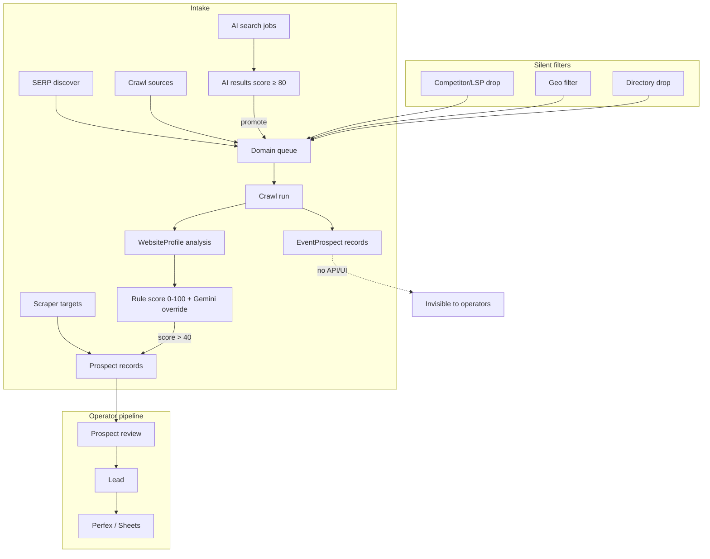

# Dashboard Frontend — Rework Reference

**Last reanalysis:** July 2026

This document is a **living spec + audit** of the React dashboard (`frontend/`). It captures what exists today, what is missing, and what should be built next — with emphasis on **improving the volume and quality of qualified leads** reaching CRM.

---

## 1. What this app is

A **session-authenticated SPA** for operating a translation-lead pipeline:

| Domain | Purpose | Staff can… | Admin additionally… |
|--------|---------|------------|---------------------|
| **Scraper** | Pull event listings from configured URLs (CSS selectors) | Create/edit targets (wizard + manual), trigger scrapes, view runs | See all users' targets/runs, trigger any target |
| **Crawler** | Discover domains (SERP / AI), crawl sites, score prospects | Discover, queue domains, monitor runs, AI search + promote | Manage global sources, reset failed domains, cancel runs |
| **Pipeline** | Qualify prospects → leads → CRM | Bulk/row actions on prospects & leads, CSV export | Cross-user pipeline tables, export |

**Users**

- **Staff** (`role: staff`): Django group `scraper` (`SCRAPER_GROUP_NAME`), **not** `is_staff`. Routes under `/`.
- **Admin** (`role: admin`): Django `is_staff`. Routes under `/admin`.
- Same login (`/login`); `ProtectedRoute` enforces role separation.

**Backend:** JSON under `/dashboard/api/*`. Dev: Vite `:5173` proxies `/dashboard` → Django `:8000`.

**Legacy:** Django template dashboard at `/dashboard/` still exists (HTML forms for manual prospect/lead create, crawl source CRUD). React has largely superseded it but some workflows remain HTML-only.

---

## 2. Implementation snapshot (July 2026)

Since the original audit, significant frontend work landed. This section corrects outdated assumptions from the first draft.

### 2.1 Implemented end-to-end (React + API + backend)

| Area | Status | Notes |
|------|--------|-------|
| Auth + role guards | ✅ | Session cookie, staff/admin separation |
| Scraper targets + wizard | ✅ | `TargetWizardPanel` uses `/dashboard/wizard/*` APIs |
| Scrape runs list + detail | ✅ | Polling, retry failed |
| Crawler hub + sub-routes | ✅ | `CrawlerLayout` with discover/domains/runs/ai-search |
| Crawl run detail + domain scores | ✅ | Shows `score` + `score_label` per domain |
| AI search + promote | ✅ | Score column, promote to prospect pipeline |
| Prospects + leads lists | ✅ | `DataTable`, server pagination, URL-synced filters, debounced search |
| Admin pipeline | ✅ | Tabbed prospects/leads tables (not just links) |
| Admin users, audit, monitoring, settings | ✅ | |
| CSV export buttons | ✅ | Basic links on prospects, leads, admin pipeline |
| SSE on staff home | ✅ | `useRunsStream` with polling fallback |
| Shared UI layer | ✅ | `DataTable`, `PageHeader`, `StatusBadge`, `Input`, `Select`, `useServerList` |

### 2.2 Partially implemented

| Area | What exists | What's missing |
|------|-------------|----------------|
| Prospect/lead detail | Read-only cards + row actions | Source, notes, score, edit forms, enrichment status |
| CSV export | Download links | Active filters (`status`, `search`, `source`, dates) not passed to export URL |
| Notifications | Backend creates on scrape complete/fail | No React UI; `fetchNotifications` not wired |
| CRM sync | Per-lead sync in UI | Bulk CRM sync endpoint exists, not in React client |
| Prospect API fields | Serializer returns `source_name`, `source_url`, `notes` | TS `Prospect` type omits them; list/detail UI doesn't show them |
| v1 list filters | `status` + `search` | No `source`, `date_from`/`date_to`, score, or quality tier |
| Target operations | Per-target trigger | `POST /v1/targets/trigger/` (trigger all) not exposed |
| Detail pages | Still in `pages/` | Import deprecated `@/lib/api/dashboard` re-export |

### 2.3 Backend-only (no API or UI)

| Feature | Backend location | Impact on lead quality |
|---------|------------------|------------------------|
| **EventProspect** | `crawler/models.py`, `event_processor.py` | Event-level scored prospects with urgency, languages, dates — **never surfaced to operators** |
| **Scraper stage-2 enrichment** | `scraper/services/enrichment.py`, `enrich_prospects` CLI | Fills email/phone from detail pages — **no UI trigger** |
| **Competitor/LSP filtering** | `competitor_filter.py`, `competitor_deriver.py` | Drops bad domains silently — **no visibility into drops** |
| **Geo filter** | `geo_filter.py` | East Africa strict mode — **no UI config or drop analytics** |
| **Directory filter** | `directory_filter.py` | Drops aggregators — **preview shows some drops, no aggregate stats** |
| **WebsiteProfile** | `crawler/models.py` | Rich scoring inputs (org types, languages, signals) — **only visible indirectly via crawl run domain results** |
| **Lead value** | `Lead.lead_value` field | Never auto-calculated or editable in SPA |
| **Manual prospect/lead create** | HTML `ProspectCreateView`, `LeadCreateView` | Operators can't add leads from SPA |
| **Perfex CRM** | `crm_integration/` | Disabled by default (`PERFEX_SYNC_ENABLED=0`) |

### 2.4 Junk / cleanup

- `frontend/src/shared/api/admin_new.ts` — untracked duplicate of `admin.ts`
- `frontend/src/shared/api/test_write.txt` — stray test file
- `lib/api/dashboard.ts` — deprecated re-export; detail pages still import from here

---

## 3. Lead quality: how the system works today

Understanding the backend quality pipeline is essential before adding UI. Good leads depend on **filtering bad intake**, **scoring good intake**, **enriching thin records**, and **prioritizing operator review**.



### 3.1 Scoring thresholds (env-configurable)

| Stage | Threshold | Config | Visible in UI? |
|-------|-----------|--------|----------------|
| Crawl → prospect creation | > 40 | `CRAWLER_MIN_SCORE_THRESHOLD` | Only on crawl run domain results |
| AI search result save | ≥ 80 | `AI_SEARCH_MIN_SCORE` | AI search results table |
| AI search promote | ≥ 80 | `AI_SEARCH_PROMOTE_MIN_SCORE` | Promote button disabled below threshold |
| Event prospect accept | 60–70+ | `event_validation.py` | **Not exposed** |

### 3.2 What makes a "good" lead in this codebase

A high-quality lead typically has:

1. **Verified contact** — email or phone (enrichment fills gaps from listing pages)
2. **Translation need signal** — score + reasoning from Gemini or rule-based profile
3. **Not a competitor** — LSP/translation agency filtered out
4. **Geo fit** — East Africa focus when strict mode on
5. **Actionable context** — event name, org type, international signals, upcoming dates (EventProspect)
6. **Complete CRM fields** — name, position, address before Perfex sync

**Current operator workflow** treats all `new` prospects equally in a flat list sorted by `created_at`. Score, source, and enrichment status are not used for prioritization.

---

## 4. Gaps hurting lead quality output

These are the highest-impact problems — ordered by how directly they affect whether operators convert **good** leads vs wasting time on **low-quality** ones.

### 4.1 Critical — invisible quality signals

| Gap | Problem | Recommendation |
|-----|---------|----------------|
| **No score on prospects** | Crawler creates prospects from scored domains but `Prospect` model doesn't store score; operators can't sort/filter by quality | Add `translation_need_score` + `score_label` to Prospect (or join via `WebsiteProfile` / `CrawlRunDomainResult`) and expose in list + detail |
| **EventProspect has no UI** | Backend creates rich event-level records (`urgency_score`, `event_date`, `languages_involved`, `translation_services_needed`) but operators never see them | New `/event-prospects` page + API v1 endpoints; link to promote → Prospect or direct convert |
| **Source not shown in pipeline** | Can't tell scraper vs crawler vs AI origin; can't filter underperforming sources | Show `source_name` / `source_url` in prospect list + detail; add `source` filter to v1 API (export already supports it) |
| **Dropped domains invisible** | Competitor/geo/directory drops happen silently; operators don't know intake is being filtered | Discovery analytics page or expand discover preview: "X dropped (competitor/geo/directory)" with reasons |

### 4.2 High — review workflow inefficiency

| Gap | Problem | Recommendation |
|-----|---------|----------------|
| **Flat prospect inbox** | 25+ new prospects trigger home banner but no "quality queue" | **Priority inbox**: default sort by score desc; tabs for High (≥60) / Medium / Needs enrichment |
| **No enrichment trigger** | Thin scraper prospects (listing-only email) stay thin | "Enrich" action on prospect detail → calls new API wrapping `enrich_prospects` logic |
| **Detail pages too thin** | No notes, source, website, phone, raw payload, linked crawl result | Expand detail; link to originating `CrawlRunDomainResult` or AI search result |
| **Export ignores filters** | Operators export unfiltered CSV when reviewing a subset | `prospectsExportUrl({ status, search, source, ... })` matching list state |
| **No bulk CRM sync** | Interested leads synced one-by-one | Wire `POST /dashboard/api/leads/bulk/sync-crm/` on leads page |

### 4.3 Medium — intake configuration & observability

| Gap | Problem | Recommendation |
|-----|---------|----------------|
| **No quality metrics** | Home shows counts, not conversion rates or score distribution | Add metrics: prospects by score tier, reject rate by source, crawl drop reasons, AI promote rate |
| **Thresholds env-only** | Operators can't see or tune `CRAWLER_MIN_SCORE_THRESHOLD` etc. | Admin settings: read-only display of thresholds + links to env docs; future: runtime config |
| **Trigger all targets** | Manual one-by-one scrape for many targets | Button on targets page → `POST /v1/targets/trigger/` |
| **Notifications unwired** | Scrape complete/fail notifications created but never shown | Notification bell in header or toast on SSE events |
| **Perfex off by default** | CRM sync path untested in many deployments | Settings page already shows status; add setup guide + enablement checklist |

### 4.4 Lower — hygiene & admin

| Gap | Recommendation |
|-----|----------------|
| Manual prospect/lead create (HTML only) | Add create forms in SPA |
| Prospect/lead field editing | PATCH endpoints + edit forms on detail pages |
| Duplicate detection UI | Surface `raw_payload_hash` collisions; merge UI |
| `lead_value` automation | Score-to-value mapping on convert |
| Legacy Django HTML parity | Redirect or deprecate `/dashboard/` template views |

---

## 5. Missing pages & features (prioritized for lead quality)

### 5.1 New pages to add

| Priority | Route | Purpose | Backend work needed |
|----------|-------|---------|---------------------|
| **P0** | `/prospects?sort=score` or `/prospects/priority` | Quality-sorted prospect inbox with score + source columns | Expose score on Prospect serializer; optional `min_score` filter |
| **P0** | `/event-prospects` | Review event-level opportunities (dates, urgency, languages) | New v1 CRUD/list API for `EventProspect` |
| **P1** | `/crawler/quality` or expand `/crawler/discover` | Drop analytics: competitor, geo, directory rejection counts | Aggregate endpoint from discovery qualify logs |
| **P1** | `/pipeline` (staff) | Unified Prospects \| Leads \| Event prospects tabs | Mostly frontend composition |
| **P1** | `/prospects/:id` (enhanced) | Full context: source, score, enrichment, linked crawl/AI result | Join data in detail serializer |
| **P2** | `/leads/ready-to-sync` | Filter `interested` leads with complete CRM fields | Lead list filter + field completeness check |
| **P2** | `/admin/quality` | Cross-user quality funnel metrics | New metrics endpoint |
| **P2** | `/notifications` | In-app notification center | Wire existing `Notification` model + API |

### 5.2 Features to add to existing pages

| Page | Addition | Lead quality impact |
|------|----------|----------------------|
| **Prospects list** | Score column, source column, sort by score, min-score filter | Operators work highest-value first |
| **Prospects list** | Export with active filters | Accurate outreach lists |
| **Prospect detail** | Enrich button, notes editor, reject reason, source link | Better contact data before convert |
| **Leads list** | Bulk CRM sync, `lead_value` column, field completeness indicator | Faster CRM handoff |
| **Crawl run detail** | Link from domain result → created prospect | Traceability |
| **AI search** | Show drop count / below-threshold results (read-only) | Understand search coverage |
| **Staff home** | Quality KPIs: high-score new count, enrichment backlog, sync-ready leads | Daily prioritization |
| **Targets** | Trigger all enabled, enrichment status per target's prospects | Scraper throughput |
| **Admin settings** | Score thresholds display, Perfex setup wizard | Configuration visibility |

### 5.3 API endpoints to add or extend

| Endpoint | Purpose |
|----------|---------|
| `GET /v1/prospects/?source=&min_score=&sort=score` | Quality-filtered prospect list |
| `GET /v1/prospects/:id/` (extended) | Include score, crawl result id, ai result id, enrichment status |
| `POST /v1/prospects/:id/enrich/` | Trigger stage-2 enrichment |
| `PATCH /v1/prospects/:id/`, `PATCH /v1/leads/:id/` | Field editing |
| `GET/POST /v1/event-prospects/` | Event prospect CRUD + promote |
| `POST /v1/leads/bulk/sync-crm/` | Mirror legacy bulk sync in v1 |
| `GET /v1/metrics/quality/` | Score distribution, source performance, drop reasons |
| `GET /v1/notifications/` | Wire existing notification API |

---

## 6. Recommended roadmap (lead quality focus)

### Phase 1 — Make quality visible (1–2 weeks)

1. Extend `ProspectSerializer` + TS types with `source_name`, `source_url`, `notes`, `translation_need_score`, `score_label`
2. Add score + source columns to prospects list (staff + admin pipeline)
3. Fix export URLs to pass active filters
4. Enhance prospect/lead detail pages with source, website, phone, notes
5. Delete `admin_new.ts`, `test_write.txt`; migrate detail pages to `@/shared/api`

### Phase 2 — Prioritized review (2–3 weeks)

1. `EventProspect` API + `/event-prospects` page with urgency/date/language columns
2. Prospect list: sort by score, `min_score` filter, "Priority" default view
3. Enrich action on prospect detail (new API endpoint)
4. Bulk CRM sync on leads page
5. Link crawl domain results → prospects in crawl run detail

### Phase 3 — Intake observability (2–3 weeks)

1. Quality metrics on staff home + admin quality page
2. Discovery drop analytics (competitor/geo/directory)
3. Notifications in header
4. Trigger-all-targets on scraper page
5. Manual prospect/lead create in SPA

### Phase 4 — Optimization

1. `lead_value` auto-calculation from score
2. Duplicate detection UI
3. Runtime threshold tuning (admin)
4. Deprecate Django HTML dashboard
5. E2E tests for quality workflow: discover → score → prospect → convert → CRM

---

## 7. Tech stack (current)

| Layer | Choice | Notes |
|-------|--------|-------|
| Build | Vite 8 + React 19 + TypeScript | React Compiler enabled |
| Routing | React Router 7 | Lazy-loaded via `app/lazyPages.ts` |
| Data | TanStack Query v5 | `staleTime: 60s`, `retry: 1` |
| HTTP | Axios (`lib/api/client.ts`) | CSRF, `withCredentials` |
| Styling | Tailwind CSS 4 + shadcn radix-nova | Ateric brand tokens in `index.css` |
| Tables | `@tanstack/react-table` via `shared/components/DataTable.tsx` | Used on pipeline, admin, crawler |
| Forms | Manual state + `TargetWizardPanel`; `react-hook-form` + `zod` used in AI search schema only | |
| Icons | lucide-react | |
| Charts | recharts | Staff + admin home |

### Repository layout (current)

```
frontend/src/
├── app/                    # router, lazyPages, navigation, providers
├── contexts/AuthContext.tsx
├── components/             # layouts, ProtectedRoute, legacy admin sections
├── features/               # domain UI (primary implementation layer)
│   ├── home/
│   ├── scraper/
│   ├── crawler/
│   ├── ai-search/
│   ├── pipeline/
│   └── admin/
├── pages/                  # thin re-exports (some detail pages still here)
├── shared/
│   ├── api/                # types, scraper, crawler, pipeline, admin, metrics, wizard
│   ├── components/         # DataTable, PageHeader, StatusBadge, Input, Select, …
│   └── hooks/              # useServerList, useDebouncedValue, useRunsStream, …
└── lib/api/                # axios client + deprecated dashboard re-export
```

---

## 8. Routing reference

### Staff (`/`)

| Path | Feature module | Primary API |
|------|----------------|-------------|
| `/` | `features/home/StaffHomePage` | metrics, SSE runs stream |
| `/targets`, `/targets/:id` | `features/scraper/*` | v1 targets + wizard |
| `/runs`, `/runs/:id` | `features/scraper/*` | v1 scrape-runs |
| `/crawler/*` | `features/crawler/*` | crawl-runs, domains, legacy preview/queue |
| `/crawler/ai-search` | `features/ai-search/AiSearchPage` | v1 ai-search |
| `/prospects`, `/prospects/:id`, `/prospects/new` | `features/pipeline` | v1 prospects |
| `/leads`, `/leads/:id`, `/leads/new` | `features/pipeline` | v1 leads |

### Admin (`/admin`)

| Path | Feature module |
|------|----------------|
| `/admin` | `features/admin/AdminHomePage` |
| `/admin/users` | `AdminUsersPage` |
| `/admin/scraper/*` | `features/admin/scraper/*` |
| `/admin/crawler/*` | `features/admin/crawler/*` |
| `/admin/ai-search` | `AiSearchPage variant="admin"` |
| `/admin/pipeline` | `AdminPipelinePage` — tabbed prospects/leads |
| `/admin/quality` | `AdminQualityPage` — quality funnel + discovery drops |
| `/admin/monitoring` | `AdminMonitoringPage` |
| `/admin/audit` | `AdminAuditPage` |
| `/admin/settings` | `AdminSettingsPage` |

---

## 9. API surface gaps (frontend ↔ backend)

### Wired in React

- Auth, scraper v1, crawler v1 (+ **crawl sessions** on `/crawler`), AI search v1 + promote, pipeline v1, admin v1, metrics, wizard, basic CSV export links, SSE runs stream (staff home)

### Backend exists, React missing

| Feature | Backend path |
|---------|--------------|
| Bulk CRM sync | `POST /dashboard/api/leads/bulk/sync-crm/` |
| Trigger all targets | `POST /dashboard/api/v1/targets/trigger/` |
| Notifications | `GET /dashboard/api/notifications/` |
| Export with filters | `GET /dashboard/export/prospects/csv/?status=&source=&search=&date_from=&date_to=` |
| Per-run SSE | `GET /dashboard/api/v1/stream/runs/:runId/` |

### Neither backend nor frontend

| Feature | Needed for |
|---------|------------|
| EventProspect v1 API | Event-based lead review |
| Prospect enrich endpoint | Stage-2 contact enrichment from UI |
| Quality metrics endpoint | Dashboard KPIs |
| Prospect score on list | Priority inbox |
| Discovery drop aggregates | Intake observability |

---

## 10. Domain model notes

### Prospect (pipeline)

- Status: `new` → `contacted` → `converted` | `rejected`
- Has `source_name`, `source_url`, `raw_payload`, `notes` in DB — **most not shown in UI**
- **No score field** — quality from crawl is lost at prospect creation time

### Lead

- Status: `contacted` → `interested` → `synced` | `rejected` | `error`
- `lead_value` exists but unused in UI
- CRM sync from `interested` only (Perfex via Celery)

### EventProspect (backend only)

- Rich event metadata: `event_date`, `urgency_score`, `translation_need_score`, `languages_involved`, `translation_services_needed`
- Status workflow: `new` → `contacted` → `qualified` → `converted` | `expired` | `irrelevant`
- Created by `event_processor.py` during crawl — **operators cannot access**

### CrawlRunDomainResult

- Per-run domain outcome with `score`, `score_label`, contact fields, `prospect_created`
- **Best place today to see quality before prospect exists** — shown on crawl run detail only

---

## 11. Known technical debt

1. **Detail pages** still import `@/lib/api/dashboard` instead of `@/shared/api`
2. **Duplicate admin client** — `admin_new.ts` untracked copy of `admin.ts`
3. **Admin/staff table duplication** — parallel crawler/scraper admin sections
4. **Legacy HTML dashboard** — dual maintenance, manual create only there
5. **Query key inconsistency** — `crawl-runs-home` vs `crawler-runs-page` etc.
6. **No toast system** — `AlertBanner` per page only
7. **No ConfirmDialog** — `window.confirm` in some flows
8. **Prospect TS type drift** — serializer fields ⊃ frontend type

---

## 12. Rebuild / parity checklist

Prioritized for **lead quality output**. Check off as shipped.

### P0 — Quality visibility

- [x] Prospect list: score, source, sort by score
- [x] Prospect detail: source, website, phone, notes, score reasoning
- [x] Export CSV with active list filters
- [x] Fix TS types to match `ProspectSerializer`
- [x] Migrate detail pages to `@/shared/api`

### P1 — Quality workflow

- [x] EventProspect API + `/event-prospects` page
- [x] Prospect enrich action (API + UI)
- [x] Bulk CRM sync on leads page
- [x] Crawl run detail → link to created prospect

### P2 — Intake & observability

- [x] Quality metrics on staff home
- [x] Discovery drop analytics
- [x] Notifications UI
- [x] Trigger all targets
- [x] Admin quality dashboard

### P3 — Foundation / hygiene

- [x] Manual prospect/lead create in SPA
- [x] PATCH edit on prospect/lead detail
- [x] `lead_value` automation
- [x] Duplicate detection UI
- [x] Remove `admin_new.ts`, `test_write.txt`
- [x] Deprecate Django HTML dashboard (redirect when `DJANGO_SERVE_SPA=1`)
- [x] E2E: discover → score → prospect → convert → CRM (API integration test)

### Already done ✅

- [x] Feature-based folder structure (`features/`)
- [x] Split API modules (`shared/api/`)
- [x] DataTable + server pagination on pipeline lists
- [x] URL-synced filters + debounced search
- [x] Target wizard (platform detect + create)
- [x] Admin pipeline tables (not just links)
- [x] SSE on staff home with polling fallback
- [x] Shared PageHeader, StatusBadge, Input, Select
- [x] AI search with score + promote
- [x] Crawl run domain results with scores

---

## 13. Dev reference

```bash
# Terminal 1 — Django (backend/)
python manage.py runserver

# Terminal 2 — Vite (frontend/)
npm install && npm run dev
# → http://localhost:5173/login

# Production
npm run build   # → frontend/dist/
# DJANGO_SERVE_SPA=1 serves SPA from Django
```

| Variable | Purpose |
|----------|---------|
| `VITE_API_BASE` | Cross-origin API; empty = relative |
| `VITE_DJANGO_PROXY_TARGET` | Vite proxy target |
| `CRAWLER_MIN_SCORE_THRESHOLD` | Min crawl score to create prospect (default 40) |
| `AI_SEARCH_MIN_SCORE` | Min score to save AI result (default 80) |
| `PERFEX_SYNC_ENABLED` | Enable CRM sync (default 0) |

```bash
python manage.py createsuperuser    # admin SPA
python manage.py create_staff_user  # staff SPA
```

---

## 14. File index

| File | Role |
|------|------|
| `src/app/router.tsx` | All routes |
| `src/shared/api/types.ts` | Entity types (needs score/source on Prospect) |
| `src/shared/api/pipeline.ts` | Prospects + leads API |
| `src/features/pipeline/ProspectsPage.tsx` | Staff prospect inbox |
| `src/features/crawler/CrawlerRunDetailPage.tsx` | Domain scores visible here |
| `src/features/ai-search/AiSearchPage.tsx` | AI search + promote |
| `backend/crawler/scoring.py` | Rule-based website scoring |
| `backend/crawler/services/event_processor.py` | EventProspect creation |
| `backend/dashboard/api/serializers.py` | ProspectSerializer (extend for score) |
| `backend/leads/models.py` | Prospect + Lead models |

---

*Update this doc when API routes, scoring logic, or major pages change.*
